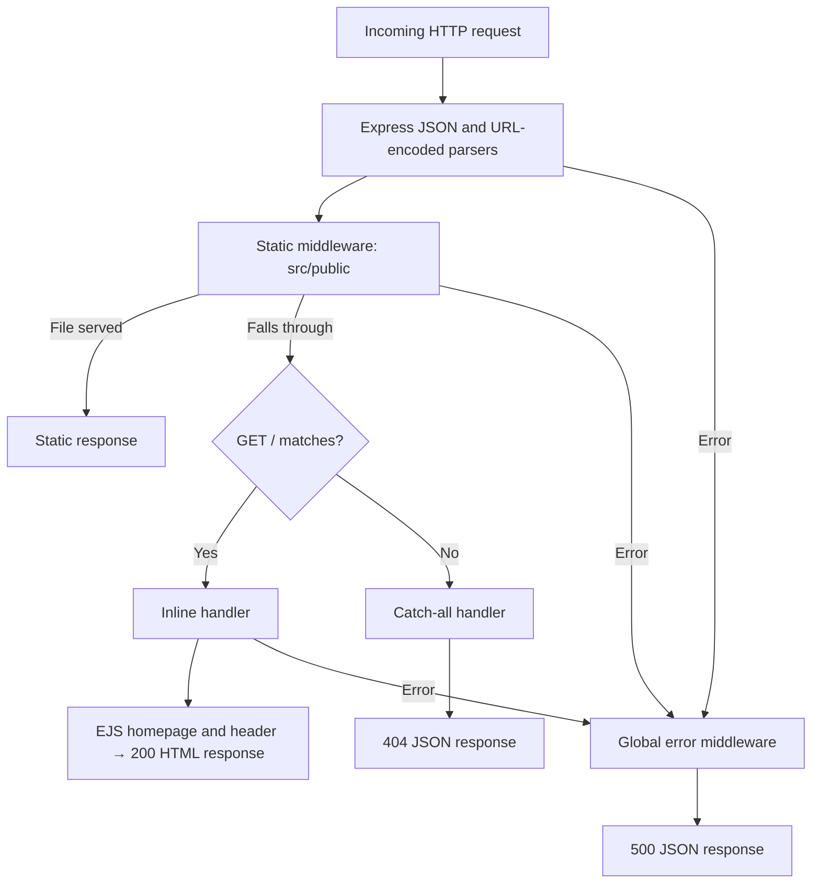

# Application Architecture

## Overview

Portfolio Resurrection is an early-stage Node.js/Express portfolio using server-side EJS rendering. The root route renders a homepage with a responsive header and animated hero; the application also serves static assets and JSON error responses. It has no Angular application, database, authentication, external integrations, or separate frontend build pipeline.

## Verified technologies

| Technology | Configuration and responsibility |
| --- | --- |
| Node.js | Runtime using ES modules and `import.meta.dirname`; no runtime version is pinned. |
| Express | Manifest `^5.3.0`; lockfile `5.3.0`. HTTP routing, middleware, and static delivery. |
| EJS | Manifest `^7.0.2`; lockfile `7.0.2`. Renders the homepage and shared header partial. |
| npm | Lockfile-based dependency installation and start, development, and test scripts. |
| HTML/CSS | Responsive header, CSS custom properties, and unused 404 template. |

Express and EJS are the only direct dependencies. Tailwind CDN references belong to design mockups, not an installed application styling framework.

## Structure and responsibilities

```text
server.js                         HTTP listener and server error event handling
src/
  app.js                          Express initialization, inline route, middleware
  views/404.ejs                   Unused HTML error template
  views/pages/homepage.ejs        Homepage document, hero and header include
  views/partials/header.ejs       Shared responsive header
  views/partials/footer.ejs       Responsive footer and mobile bottom navigation
  public/css/theme.css            Static theme variables
  public/css/header.css           Header layout and responsive styling
  public/css/footer.css           Footer layout and mobile safe-area spacing
  public/css/homepage.css         Responsive hero styling
  public/js/header.js             Mobile dropdown behavior
docs/designs/
  luminescent_precision/DESIGN.md Design specification
  desktop_portfolio_homepage_1440px/  HTML and PNG design references
  tablet_portfolio_homepage_768px/    HTML and PNG design references
  mobile_portfolio_homepage_390px/    HTML and PNG design references
package.json                      ES module declaration, dependencies, scripts
package-lock.json                 Locked dependency tree
.gitignore                        Excludes node_modules, .env, logs, macOS metadata
```

## Initialization and configuration

`server.js` imports the exported Express app from `src/app.js`, listens on `process.env.PORT || 3000`, and logs the listening port. A server `error` event logs the error and sets `process.exitCode = 1`.

The app selects `ejs` as its view engine, then registers middleware in this order:

1. `express.json()`.
2. `express.urlencoded({ extended: true })`.
3. `express.static(...)`, resolving `src/public` relative to the app module.
4. Inline `GET /` handler.
5. Catch-all JSON 404 handler.
6. Four-argument error middleware returning JSON 500.

The `views` setting resolves `src/views` relative to the app module. The root handler calls `res.render('pages/homepage')`, which includes `../partials/header`.

## Actual request lifecycle



The root request flow is request → middleware → route handler → EJS rendering → HTML response. See [HTTP interface](api.md) for response details.

## Skills page

`GET /skills` renders `src/views/pages/skillsPage.ejs`, reusing the header with Skills highlighted and linked in desktop/mobile navigation. `/css/skillsPage.css` styles Technologies & Capabilities: an expertise badge, responsive heading, description, and four technology pills. A subtle, top-centered blue-to-cyan glow follows the tablet reference at desktop, tablet, and mobile widths. A non-interactive blurred CSS pseudo-element provides the glow without a grid background. Engineering Capabilities follows the hero divider with four semantic article cards: Application Architecture, API Development & Integration, Authentication & Security, and Performance & Reliability. The design references determine the copy, dark surfaces, blue decorative inline SVG icons, borders, and responsive spacing; CAP badges are omitted. CSS uses a two-column grid from 768px and stacked cards below 768px, without hover effects. No additional dependencies or client-side scripts are required. Modern Development Workflow follows with a semantic ordered list of Plan, Build, Test, Review, and Deploy stages, decorative accent bars (blue, with green for Deploy), and an AI-assisted workflow callout. Its grid uses five columns at 1024px and above, three from 768px to 1023px, and one below 768px. Stage numbers follow the breakpoint references, with only Deploy numbered on tablet. Cards are informational, not interactive controls or live progress indicators. Experience Beyond the Code follows with four semantic article cards covering site reliability and technical support, data operations and systems, technical training and collaboration, and full-stack software development. Each card has a description and a four-item skill list. The grid uses two columns from 768px and stacks below 768px; all screen sizes show category labels and decorative inline SVG icons. Desktop and tablet share the same card typography, rounded tags, and 16px corners, with larger desktop padding and grid spacing; mobile retains its compact layout. Skills in Action selects the first two records in `data/skillsProjects.json` using `skillsProjects.slice(0, 2)` in the page template and renders those project cards, side by side on desktop, stacked with split information/preview columns on tablet, and stacked vertically on mobile. A shared EJS preview partial selects the illustrative route or planned architecture by project ID. Its base and responsive styles live in `/css/skills-project-preview.css`; views reusing the partial should load this stylesheet alongside `/css/theme.css`. The page stylesheet retains the surrounding project card and section layout. The route passes the complete project array, so additional records remain available for other views without appearing in Skills in Action. Skills in Action cards use the former tablet capability-card hover treatment: a blue border and soft blue shadow, with transitions disabled for reduced motion. Tablet cards use 20px padding and 16px corners. Hover changes elsewhere on the Skills page, including shared header/footer elements, are disabled; focus, current-page, and expanded-menu states remain available. The homepage retains its hover behavior. The page includes the shared footer partial and loads `/css/footer.css`.

`data/skillsProjects.json` stores the Developer Portfolio Application and Full-Stack Business Application design records, including descriptions, technology arrays, reference statuses, and an `actions` array with Live Demo and GitHub Source labels and null URLs. The `/skills` route imports these records and passes `skillsProjects` to EJS; titles, descriptions, statuses, technologies, and action labels are escaped when rendered. Each project’s `actions` array defines `type` (demo/source), `label`, and `url`. Both links render as styled buttons with individual hover backgrounds, border highlights, shadows, and a subtle lift. Null URLs produce disabled links without destinations; button hover styling is independent of the card hover. Transitions respect reduced motion. The code preview is static illustrative markup and the architecture preview describes the planned business application; neither executes code or verifies infrastructure. The Live Production label is design copy, not verification of deployment.

## Routes, templates, and styling

Routing uses `app.get()` directly; there are no separate routers, controllers, or services. The root handler renders the homepage without consuming parameters or parsed bodies.

`src/views/404.ejs` contains static HTML displaying “Page Not Found.” It has no dynamic EJS expressions, layouts, or partials, and the 404 handler does not render it. The homepage receives only its active navigation state; the unused 404 template receives no data.

Static files are mounted at the URL root: `src/public/css/theme.css` is available at `/css/theme.css`. The theme defines reusable design variables. `/css/header.css` adds reference-specific header colors, Sora/Geist typography, and responsive layouts. The homepage loads these fonts from Google Fonts with sans-serif fallbacks. Design artifacts under `docs/designs` are outside the static root and are not served by this middleware.

### Hero tile background

Below 768px, the homepage hero fills the available viewport between the fixed 64px header and 64px bottom navigation, subtracting top and bottom safe-area insets. CSS uses `100dvh` with a `100vh` fallback and vertically centers the content with balanced padding. A minimum height allows the hero to grow and scroll on short screens or with enlarged text. The absolute grid fills the taller hero automatically through its existing ResizeObserver; desktop and tablet sizing are unchanged.

The homepage loads `/css/hero-grid.css` and the native ES module `/js/hero-grid.js`. An `aria-hidden`, pointer-transparent grid layer sits beneath the restored hero image without changing foreground content or spacing. The image retains its right alignment, gradient masks, and desktop/tablet opacity and is hidden below 768px; both decorative layers remain behind the hero content. CSS Grid uses 44px square tiles (36px below 768px); ResizeObserver rebuilds tiles when dimensions change. The grid occupies the left 50% of the hero on desktop/tablet and the full width below 768px. Mobile retains only the top and bottom fades, with no horizontal fade. Intersecting masks fade in over the top 8% of the grid, leave its left edge fully visible, dissolve its right edge from 75% to 100% of the grid width toward the image, and fade out from 72% to full transparency at 96% of the hero height. The homepage body uses the theme background `#0B1018`, matching the hero and following section.

`createHeroGrid(element)` is reusable and returns a cleanup function. Random timeouts every 160–320ms select individual tiles and occasional adjacent pairs, capped at eight active flips with a six-second per-tile cooldown. Flips take 1000–1500ms and complete a full rotation with gentle acceleration and deceleration, returning to the original orientation without a reset snap. Independent random blue border pulses last 900–1400ms, with a 65% chance per scheduling tick, at most five active, and a five-second per-tile cooldown. Border overlays animate opacity without affecting tile layout or flap shading. Only transforms and pseudo-element opacity animate. Reduced motion retains the static grid. Visibility and intersection observers suspend animation when hidden or offscreen. Page exit clears timers, disconnects observers, and removes instance listeners; page restoration mounts fresh instances.

Tune timing, duration, cooldown, group/accent probability, concurrency, and border-pulse settings in `CONFIG` in `hero-grid.js`. Tune tile sizes, surface/border/accent colors, accent and border-flash opacity, perspective, and fade stops in `hero-grid.css`. No dependencies or API changes are required.

### Responsive footer

The homepage, Skills page, and About page include `src/views/partials/footer.ejs` after `main` and load `/css/footer.css`. Desktop and tablet share branding with a tagline, social placeholders, and separate copyright text on a dark surface, wrapping as needed. Below 768px, a fixed bottom navigation bar replaces the desktop footer; body padding reserves its height and the device safe area. Overview links to `/`; Projects links to Skills in Action at `/skills#projects`. On the homepage, no navigation item is current. On the Skills page, the same item is labeled Skills, links to `/skills`, and is current. The route’s `activeNav` controls the footer highlight and `aria-current="page"`. Resume, Connect, and social profiles remain unavailable links until their destinations exist. Icons use decorative inline SVG; no JavaScript or dependencies are added.

### Responsive header behavior

Desktop and tablet (768px and above) share the desktop reference styling and an 80px fixed header. Below 768px, a 64px header displays the mobile reference layout with safe-area support. An initials logo and `/images/profile_black_white_avatar_photo.png` serve as the header branding and avatar; the photo uses a circular 32px crop. The hero follows the desktop, tablet, and mobile references in `docs/designs/homepage`. It uses a shared metrics strip on desktop, four individual cards on tablet, and a two-column metrics grid with stacked actions on mobile. Responsive copy variants use CSS display rules. Decorative inline SVG icons need no additional dependencies. Hero Projects and Contact actions use the same unavailable-link convention until their destinations exist. The reference copy and metric values remain design content pending personalization.

Header Projects links navigate to `/` and Skills links navigate to `/skills` on desktop and mobile. Remaining navigation and Resume placeholders use `aria-disabled="true"` without `href` or keyboard stops; they do not navigate. Navigation items are defined once in `data/navigation.js` and exposed through application locals. Both menus and the desktop Resume action use the shared `navigation-link.ejs` partial. Skills, About, and Contact routes explicitly supply their matching `activeNav` identifier. The homepage uses the null default, so no header or footer navigation item is highlighted at `/`. Available links matching this identifier receive `aria-current="page"`, which drives active styling on desktop and mobile. The mobile button controls a hidden dropdown through `aria-controls` and `aria-expanded`. A deferred script toggles it and closes it on Escape, outside click, or breakpoint changes; Escape returns focus to the button. No client framework is used.

## Middleware, errors, and security

Body parsers are registered, but there are no form submission handlers, domain validation, or sanitization routines. Parsing failures reach the global handler, which always responds with status 500 rather than preserving an error's original status.

Unknown requests return a generic JSON 404. The global error handler returns a generic message without exposing a stack trace; its current logging statement reads `error.error`. Server event errors are logged separately by `server.js`.

There is no custom authentication, authorization, session handling, rate limiting, CORS configuration, CSRF protection, or security-header middleware. `.env` is excluded from Git. No application route currently interpolates user input into HTML.

## Environment and deployment

| Setting | Behavior |
| --- | --- |
| `PORT` | HTTP listener port; defaults to `3000`. |
| Development | `npm run dev` runs `node --env-file=.env --watch server.js`; requires a local `.env` file. |
| Standard startup | `npm start` runs `node server.js`; reads process environment without automatically loading `.env`. |

No other environment variables are read explicitly by application source. No secret values are required by the implemented handlers.

Render is identified as the intended hosting target in project documentation. No Render configuration, container definition, CI deployment workflow, or verified live deployment URL is present. TODO: Document the verified hosting configuration when available.

## Decisions, tradeoffs, and remaining work

- Separating the app from its listener permits importing the app without starting the production listener.
- Inline handlers keep the current small application simple; controller and service layers have not been introduced.
- Static asset and view directory paths are module-relative.
- Generic JSON errors limit internal details in responses, but the fixed 500 status loses distinctions between client parsing errors and server errors.
- The header implements the responsive references; the animated homepage hero is implemented; remaining page sections, resume, and navigation destinations remain future work.

`npm test` invokes Node's built-in test runner; the current repository contains no discovered tests or suites. No lint or build script is defined.

## About page hero

`GET /about` renders `src/views/pages/aboutPage.ejs` with `activeNav: 'about'`. The shared navigation definition enables About at `/about`. The page reuses the header and mobile menu script, and loads scoped `aboutPage.css` after the theme and header styles. The professional-background hero, My Journey timeline, How I Approach Engineering section, Beyond the Code section, and What I’m Building Today panel are implemented; the shared footer partial is rendered after main with `/css/footer.css`.

The desktop design in `docs/designs/about_page` determines the palette, translucent profile card, and four-metric layout across all sizes. At 1024px and above, introduction and profile use a 7:5 grid; tablet and mobile stack them. Mobile reduces typography and padding while preserving desktop styling. The profile uses Nicholas C. Taylor branding; the reference persona’s location and version badge are omitted. Experience, availability, and stack labels are reference content, and the terminal/online display is static rather than a live diagnostic integration. Inline decorative SVGs avoid icon dependencies; no new client logic is introduced.

My Journey uses a semantic ordered list of five milestones following the desktop reference copy: education, configuration/training, technical operations/reliability, frontend/full-stack engineering, and current focus. Desktop translucent surfaces, phase badges, a connected vertical rail, blue markers, and the highlighted final card remain consistent across sizes; tablet/mobile reduce typography and padding and allow headings/badges to wrap. Reduced-motion preferences disable marker pulsing and transitions. Reference career copy is presented as portfolio content; the mobile-only dates and conflicting degree abbreviation are omitted in favor of the desktop reference.

How I Approach Engineering follows the timeline using the desktop reference’s dark gradient panel, blue left accent, narrative copy, and inset Core Principles card. The three principles use semantic headings and a list with decorative green inline SVG icons. The narrative and principles sit side by side at 1024px and above and stack below that breakpoint. Smaller screens adjust spacing and typography while retaining desktop colors, surfaces, icons, and copy. This section adds no client-side behavior or dependencies.

Beyond the Code follows the philosophy section with the desktop reference introduction and three semantic personal-interest cards. The translucent dark surfaces, pale-blue icon tiles, copy, rounded corners, and hover treatment remain consistent across breakpoints. Three columns appear at 768px and above; mobile stacks cards with icons beside their text. Decorative inline SVGs avoid icon dependencies, and reduced motion disables hover transitions. No client-side logic or additional About sections are introduced.

What I’m Building Today is the final implemented About section. It retains the desktop gradient surface, subtle glow, pale-blue primary project action, secondary résumé action, and social-link styling across sizes. Desktop places actions beside the copy; smaller screens stack the panel content, and mobile stacks full-width buttons. View My Projects navigates to Skills in Action at `/skills#projects`. Résumé and professional-profile destinations remain unavailable links without href attributes until configured. The GitHub and LinkedIn placeholders show a pointer cursor and pale-blue hover feedback while remaining non-navigating; the unavailable résumé action has a lighter background and pale-blue text on hover while remaining non-navigating. Transitions respect reduced motion.

## Contact page

`GET /contact` is a concise inline route in `src/app.js` that renders `src/views/pages/contactPage.ejs` with the trusted static content in `data/contact.json` and `activeNav: 'contact'`. The template reuses the shared header/footer and `partials/contact-icon.ejs` for inline SVG icons; `src/public/css/contactPage.css` contains scoped responsive styling. The desktop/tablet layout has three contact columns and two preference columns, which stack below 768px. Sora headings and Geist body text match the existing site.

Contact URLs and visible labels are maintained together in `data/contact.json`; null URLs render unavailable anchors. Availability copy is maintained in the same file. No new dependencies, client scripts, services, forms, or persistence are required. The shared navigation, mobile footer Connect link, and homepage Contact Me action point to `/contact`. The mobile footer Projects link uses `/skills#projects`.
