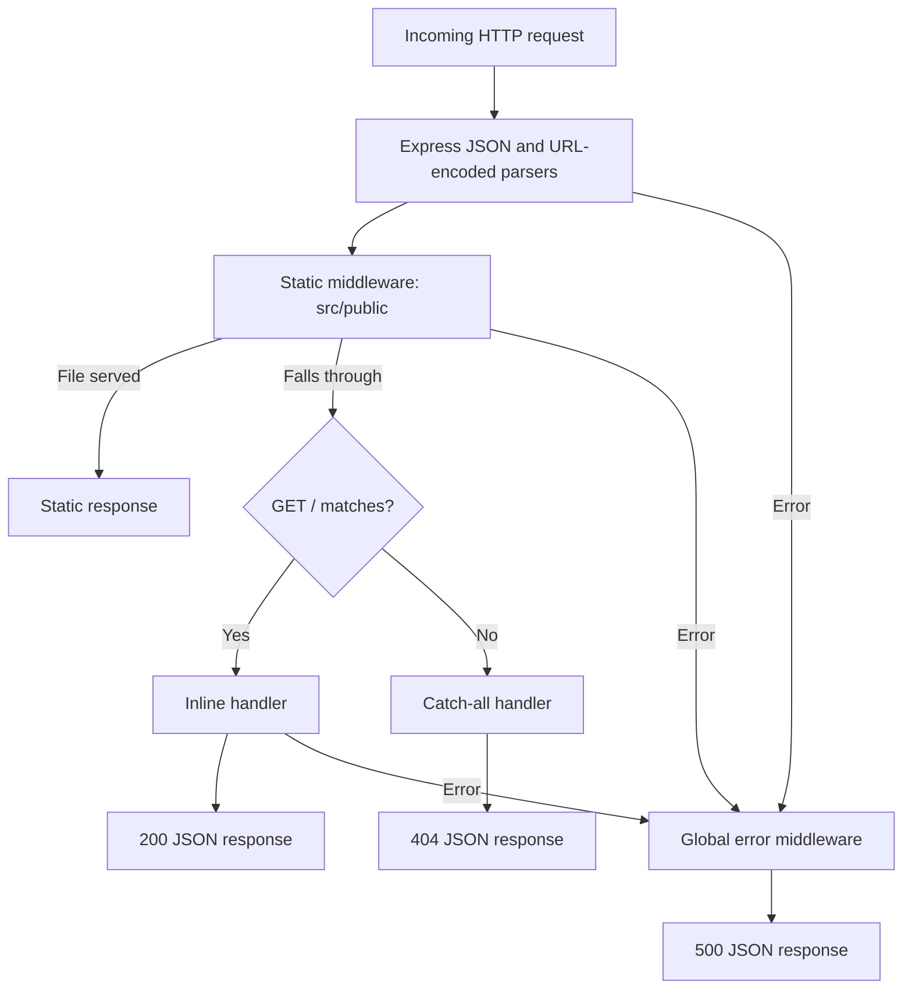

# Application Architecture

## Overview

Portfolio Resurrection is an early-stage Node.js/Express portfolio intended to use server-side EJS rendering. Currently, the application serves JSON responses and static CSS; no handler calls `res.render()`. It has no Angular application, database, authentication, external integrations, or separate frontend build pipeline.

## Verified technologies

| Technology | Configuration and responsibility |
| --- | --- |
| Node.js | Runtime using ES modules and `import.meta.dirname`; no runtime version is pinned. |
| Express | Manifest `^5.3.0`; lockfile `5.3.0`. HTTP routing, middleware, and static delivery. |
| EJS | Manifest `^7.0.2`; lockfile `7.0.2`. Selected view engine, currently unused for responses. |
| npm | Lockfile-based dependency installation and start, development, and test scripts. |
| HTML/CSS | Unused 404 template and CSS custom properties. |

Express and EJS are the only direct dependencies. Tailwind CDN references belong to design mockups, not an installed application styling framework.

## Structure and responsibilities

```text
server.js                         HTTP listener and server error event handling
src/
  app.js                          Express initialization, inline route, middleware
  views/404.ejs                   Unused HTML error template
  public/css/theme.css            Static theme variables
docs/designs/
  luminescent_precision/DESIGN.md Design specification
  desktop_portfolio_homepage_1440px/  HTML and PNG design references
  tablet_portfolio_homepage_768px/    HTML and PNG design references
  mobile_portfolio_homepage_390px/    HTML and PNG design references
package.json                      ES module declaration, dependencies, scripts
package-lock.json                 Locked dependency tree
.gitignore                        Excludes node_modules, .env, logs, macOS metadata
```

## Initialization and configuration

`server.js` imports the exported Express app from `src/app.js`, listens on `process.env.PORT || 3000`, and logs the listening port. A server `error` event logs the error and sets `process.exitCode = 1`.

The app selects `ejs` as its view engine, then registers middleware in this order:

1. `express.json()`.
2. `express.urlencoded({ extended: true })`.
3. `express.static(...)`, resolving `src/public` relative to the app module.
4. Inline `GET /` handler.
5. Catch-all JSON 404 handler.
6. Four-argument error middleware returning JSON 500.

**Rendering gap:** The intended template directory is assigned using `app.set('view', ...)`, not the `views` directory setting. This does not configure Express's template search directory. No current route exercises rendering.

## Actual request lifecycle



The intended server-rendered flow is request → middleware → route handler → EJS rendering → HTML response. The EJS and HTML response stages are not implemented in the current route flow. See [HTTP interface](api.md) for response details.

## Routes, templates, and styling

Routing uses `app.get()` directly; there are no separate routers, controllers, or services. The root handler returns JSON without consuming parameters or parsed bodies.

`src/views/404.ejs` contains static HTML displaying “Page Not Found.” It has no dynamic EJS expressions, layouts, or partials, and the 404 handler does not render it. No template data or application locals are supplied.

Static files are mounted at the URL root: `src/public/css/theme.css` is available at `/css/theme.css`. The file defines color, typography, spacing, shape, and layout variables; it does not implement a portfolio layout or load the named fonts. Design artifacts under `docs/designs` are outside the static root and are not served by this middleware.

## Middleware, errors, and security

Body parsers are registered, but there are no form submission handlers, domain validation, or sanitization routines. Parsing failures reach the global handler, which always responds with status 500 rather than preserving an error's original status.

Unknown requests return a generic JSON 404. The global error handler returns a generic message without exposing a stack trace; its current logging statement reads `error.error`. Server event errors are logged separately by `server.js`.

There is no custom authentication, authorization, session handling, rate limiting, CORS configuration, CSRF protection, or security-header middleware. `.env` is excluded from Git. No application route currently interpolates user input into HTML.

## Environment and deployment

| Setting | Behavior |
| --- | --- |
| `PORT` | HTTP listener port; defaults to `3000`. |
| Development | `npm run dev` runs `node --env-file=.env --watch server.js`; requires a local `.env` file. |
| Standard startup | `npm start` runs `node server.js`; reads process environment without automatically loading `.env`. |

No other environment variables are read explicitly by application source. No secret values are required by the implemented handlers.

Render is identified as the intended hosting target in project documentation. No Render configuration, container definition, CI deployment workflow, or verified live deployment URL is present. TODO: Document the verified hosting configuration when available.

## Decisions, tradeoffs, and remaining work

- Separating the app from its listener permits importing the app without starting the production listener.
- Inline handlers keep the current small application simple; controller and service layers have not been introduced.
- Static asset paths are module-relative, while the intended view directory configuration remains incomplete.
- Generic JSON errors limit internal details in responses, but the fixed 500 status loses distinctions between client parsing errors and server errors.
- Planned work includes EJS portfolio pages and integration of responsive design references. These are not currently delivered features.

`npm test` invokes Node's built-in test runner; the current repository contains no discovered tests or suites. No lint or build script is defined.
